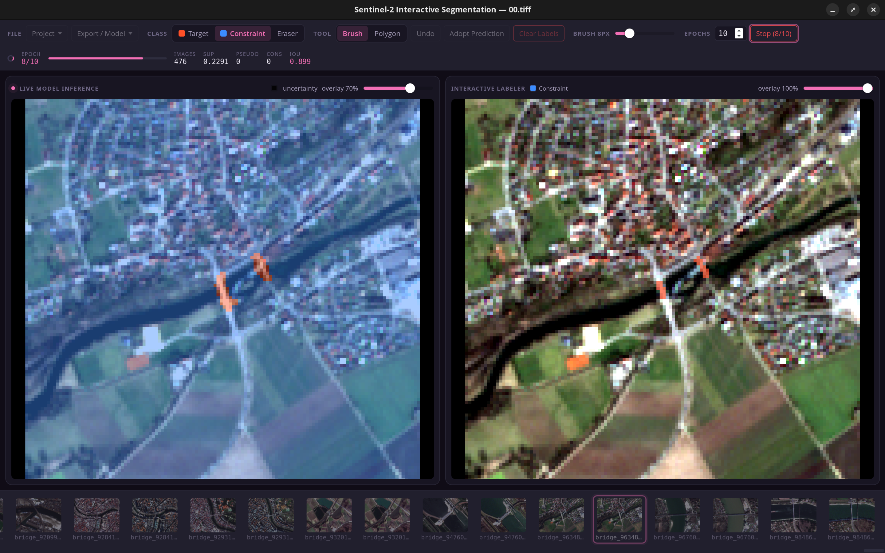

# Kaio-ken Labeler

## A label tool for Remote Sensing, supports GeoTiffs with more than just 3 Bands!



## What this build is

This is the **labeling-only** fork of the Kaio-ken Segmenter. There is no model
here: no training, no inference, no accuracy report, no ONNX export and **no
PyTorch dependency** — see [Removed from this build](#removed-from-this-build).

What remains is the part you actually label with: an editable multi-class
palette, brush, polygon, magic wand and SAM2 click-assist tools, the thumbnail
strip, and mask I/O that round-trips your GeoTIFFs without touching their
format.

## Setup & run

```bash
python3 -m venv venv
venv/bin/pip install -r requirements.txt
venv/bin/pip install "pywebview[qt]"   # bundled Qt renderer, no system GTK needed
cd frontend && npm install && npm run build && cd ..
venv/bin/python backend/main.py [path/to/image.tiff | path/to/project_dir]
```

With no argument it opens the project described by the `project_config.json` at
the repo root. There is no CUDA wheel to fetch and no multi-gigabyte torch
install — the whole dependency set is numpy, rasterio, pywebview, pillow,
onnxruntime, scipy and opencv.

SAM2 click-assist needs `sam2/onnx/*.onnx`. Those graphs are **checked in and
are the only copy**: this build has no exporter, so treat them as source, not
as a build artifact. Without them the SAM2 button and the wand's SAM-features
switch stay disabled; everything else still works.

## Projects and classes

A project is a folder of GeoTIFFs plus a `project_config.json` describing the
band profile, the class palette and where masks live. **File → Project** creates
one from a folder of tiles, or cuts a single large GeoTIFF into tiles with
**From GeoTIFF…**.

The class list is yours to define, in the same dialog, at creation and
afterwards. It starts from a preset — the 11-class land-cover set below, or a
two-class `binary` one — and every row can be renamed, recoloured, added or
removed.

Two things about class **ids**, because they are the label space and every mask
stores them:

- An id is never reused. Delete a class and the next one you add takes a fresh
  id, so a mask found in a backup can never come back meaning a different
  material.
- **Deleting a class unlabels its pixels.** The dialog scans the project first
  and tells you exactly what that costs — *"Removing Meadow (12,345 px in 7
  images)"* — and makes you confirm. It rewrites the saved masks and cannot be
  undone. AI masks are left alone.

## The dataset

`project_config.json` points at `input_images/` (34 ten-band GeoTIFFs) and
`label_raster/`.

| Index | Class | | Index | Class |
|-------|-------|-|-------|-------|
| 0 | Urban | | 6 | Shrub |
| 1 | Road | | 7 | Water |
| 2 | Agriculture-Green | | 8 | Snow |
| 3 | Raw-Earth/Agriculture | | 9 | Wetland |
| 4 | Meadow | | 10 | Synthetic Nodata |
| 5 | Forest | | | |

Pick a class from the palette left of the labeling pane, or with `1`–`9`, `0`,
`-`; `E` toggles the eraser. Past eleven classes the extra ones are click-only —
there are no more keys. The palette shows a live painted-pixel count per class
and highlights the ones still at zero, and its width is draggable by the right
border (double-click resets it).

Each class has an eye on its right that **hides it in the labeler**. Hiding is
a view setting and nothing else: the labels stay on disk, keep their pixel
count, and every tool still sees them — they are just not drawn, so you can
look at the imagery underneath. Picking a hidden class shows it again, since
painting into something invisible helps nobody.

`Ctrl+Z` undoes, `Ctrl+Shift+Z` or `Ctrl+Y` redoes. Labels autosave a second
after the last stroke, and again whenever you switch images, so the "Labeled"
pixel count in the toolbar doubles as the "your work is on disk" readout.

`input_images/` and `label_raster/` are gitignored (~140 MB) and the app edits
the labels **in place**, so back them up outside version control.

## The tools

**Brush** and **Polygon** are what they sound like; the brush radius is on the
toolbar and also on the scroll wheel.

**Wand** clicks a region and selects pixels of similar material around it,
previewed until `Enter` paints it (`Esc` discards, `Backspace` drops the last
click). Clicking again adds a sample and is *purely additive* — a later click
can never remove a pixel an earlier one selected. Right-click marks material to
exclude. The controls row carries the tolerance, the sample size, an optional
per-click pixel budget, **protect labels** (fill only where nothing is labeled
yet) and **whole image** (take every match in the scene, not just the connected
piece). `spec.txt` is the as-built specification.

The tolerance is kept **per class**, seeded from the value measured best for
each material — they range from 0.07 for Water to 0.19 for Urban, and one global
number costs about 12% mean IoU against per-class ones.

**SAM features** switches the wand from matching on the image bands to matching
on SAM2 encoder features. Measured over 60 labeled regions it is not a better
tool — 0.568 mean IoU against 0.593 — but it succeeds and fails on *different*
regions, so it is worth trying where a spectral fill will not converge. It costs
one encoder pass per image and gives up the non-visible bands the wand normally
uses, which is why it is a switch and not the default.

**Region** deletes a labeled object. Click one and it selects the **connected
region under the cursor** — not every pixel of that class, which matters here
because a class comes in dozens of separate pieces. Click more objects to add
them, `Backspace` drops the last, `Enter` or `Delete` erases them all as one
undoable step, `Esc` cancels. It reads the label buffer directly, so unlike the
wand there is no round trip and no tolerance to tune.

**SAM2** snaps a polygon to an object's edges from a click; right-click excludes.

## Mask format

The label rasters are `int32` with `nodata = -9999`, while the app works
internally in `uint8` (class ids `0..254`, `255` unlabeled). The `mask_format`
key in the project config drives the conversion both ways, so edited masks are
written back as `int32`/`-9999` and stay byte-compatible with the surrounding
GIS pipeline. `backend/test_masks.py` round-trips all the real files to keep it
that way — run it after touching mask I/O.

`project_config.json` is a shared schema, and this build validates all of it but
only manages part of it. Any key it has no concept of is read, checked and
**written back untouched** rather than reset to a default, so saving settings
here never quietly reconfigures something set up elsewhere.

## Removed from this build

| Gone | Why |
|------|-----|
| `backend/model.py`, `train.py`, `report.py` | the U-Net, the training loop and the accuracy report |
| `backend/export_sam_onnx.py` | the SAM2 → ONNX export chain; the graphs are checked in instead |
| `standalone/`, `pretraining/` | the standalone predictor and the pretrained weights |
| Train / Stop / Epochs, Adopt Prediction, Reset Model | training controls |
| The inference pane and uncertainty overlay | there is no prediction to show |
| Generate Accuracy Report | scoring needs a model |
| Export Model / ONNX / Executable / Mask | `export_mask` merged labels over a prediction; labels already autosave to the masks folder |
| The validation split and its thumbnail UI | it exists to hold images out of training |

## Tests

Plain scripts, no framework. None of them write to `label_raster/`: the ones
that only read it write their output to a temp directory, and the ones that need
to edit labels work on a scratch copy of the whole project.

```bash
python3 backend/test_masks.py    # mask round-trip, and the display stretch
python3 backend/test_sam.py      # SAM2 still matches the torch implementation
python3 backend/test_wand.py     # the wand's invariants, both distance sources
python3 backend/test_project.py  # the class palette: ids, presets, deletion
python3 backend/test_no_torch.py # nothing in this build imports torch
```

`backend/testlib.py` holds the runner they share; a new test file needs
`from testlib import fail, main` and `sys.exit(main(globals()))`.

The frontend has two harnesses, because neither covers the other's ground:

```bash
cd frontend
npm test          # vitest: hooks, components, pure functions
npm run test:watch
```

Vitest runs under happy-dom, which has **no canvas 2D context** — `src/test-setup.js`
stubs one so the app can mount, and every drawing call is a no-op. So anything
about pixels is out of scope there by construction, and an assertion about
canvas content in a `.test.js` is measuring the stub rather than the app.

That part is covered by `frontend/smoke.html`, which stubs the pywebview bridge
and drives the real app in a real browser — real canvas, real pointer events,
real layout:

```bash
cd frontend && npx vite &
google-chrome --headless --dump-dom http://localhost:5173/smoke.html \
  | grep -A99 '<pre id="result">'
```

Vite builds `index.html` only, so it never ships.

## Measuring the wand

Every default in the wand came from scoring it against this project's own
labels, and `backend/bench_wand.py` is what produced them — kept so they can be
re-derived rather than trusted:

```bash
python3 backend/bench_wand.py tolerance   # per-class tolerance sweep
python3 backend/bench_wand.py sources     # spectral vs SAM2 features
```

Both take connected regions of the saved masks as ground truth, click the most
interior pixel of each, and score by IoU. `sources` is how to test whether the
SAM-features source does better on higher-resolution imagery than it does on
10 m/px Sentinel-2 — on this dataset the two sources score the same overall and
fail on different regions, which is why it is a switch rather than a default.

## Frontend development

```bash
cd frontend && npm run dev   # hot-reload UI (bridge calls need the pywebview host)
npm run build                # rebuild dist/ used by backend/main.py
npm run lint
```

## Disclaimer

Originally built as a prototype for human-in-the-loop semantic segmentation in
remote sensing. **I also used AI code generation in this project to get
started.** **At the current state I can't guarantee that it works on every
machine!**
